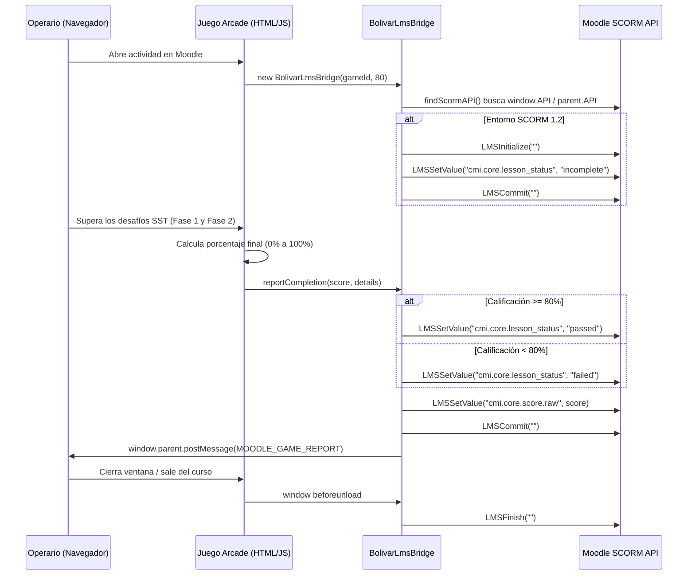

# Guía Oficial de Integración y Despliegue en Moodle LMS

> Contrato vigente (2026-10-22): [evaluación y persistencia](CORRECCIONES_2026-10-22.md). Umbral 80 % más hitos obligatorios; Emergencias reporta al completar ambas misiones. Revisitar no rebaja el estado a `incomplete`; modo revisión no escribe notas. Un error de guardado se muestra con opción de reintentar. La integración real con Moodle sigue pendiente de validación en esta sesión.
## Suite Arcade de Seguridad Química (Seguros Bolívar & KMA Construcciones)

---

## 1. Resumen Ejecutivo y Compatibilidad

Esta guía técnica está dirigida a administradores de plataforma, diseñadores instruccionales y facilitadores de SST encargados de desplegar los **5 juegos arcade de seguridad química** en la plataforma **Moodle LMS** (versiones 3.9+, 4.0, 4.1, 4.2, 4.3, 4.4, Moodle Workplace y MoodleCloud).

La suite cuenta con una capa de integración universal nativa denominada **`BolivarLmsBridge`**, incorporada en cada uno de los archivos fuente, que proporciona:
1. **Comunicación Automática SCORM 1.2 y SCORM 2004**: Detecta el entorno de Moodle y reporta en tiempo real el estado de lección (`passed` / `failed`), la calificación numérica (0 a 100 puntos) y los intentos al **Libro de Calificaciones (Gradebook)** de Moodle.
2. **Soporte de Incrustación iFrame con API postMessage**: Permite utilizar los juegos embebidos en etiquetas o páginas HTML de Moodle emitiendo eventos estándar `MOODLE_GAME_REPORT`.
3. **Botón Integrado de Pantalla Completa (`btn-moodle-fullscreen`)**: Soluciona la limitación de visualización dentro de temas estrechos de Moodle, permitiendo al operario expandir el juego al 100% de la pantalla de su computador o teléfono móvil con un solo clic.

---

## 2. Catálogo de Paquetes SCORM Disponibles

Todos los paquetes listos para subir a Moodle se encuentran compilados en el directorio `scorm_packages/`:

| Archivo ZIP | Actividad en Moodle | Estándar | Mastery Score | Variables Reportadas al Gradebook |
| :--- | :--- | :--- | :--- | :--- |
| `scorm_packages/juego1_sga_scorm.zip` | **Juego 1: Desafío SGA** | SCORM 1.2 | 80 pts | `cmi.core.score.raw` (0-100), `lesson_status` |
| `scorm_packages/juego2_bodega_scorm.zip` | **Juego 2: Bodega Segura** | SCORM 1.2 | 80 pts | `cmi.core.score.raw` (0-100), `lesson_status` |
| `scorm_packages/juego3_trasiego_scorm.zip` | **Juego 3: Inspector de Trasiego** | SCORM 1.2 | 80 pts | `cmi.core.score.raw` (0-100), `lesson_status` |
| `scorm_packages/juego4_taller_scorm.zip` | **Juego 4: Taller Seguro** | SCORM 1.2 | 80 pts | `cmi.core.score.raw` (0-100), `lesson_status` |
| `scorm_packages/juego5_emergencias_scorm.zip` | **Juego 5: Brigada de Emergencia** | SCORM 1.2 | 80 pts | `cmi.core.score.raw` (0-100), `lesson_status` |
| `scorm_packages/suite_completa_5juegos_scorm.zip` | **Suite Completa (5 Juegos Multi-SCO)**| SCORM 1.2 | 80 pts | Paquete combo con los 5 módulos en un solo recurso |

---

## 3. Método 1: Despliegue como Paquete SCORM (Recomendado)

Este es el método oficial y estándar para registrar notas automáticas en Moodle.

### Paso 1: Ingresar al Curso y Activar Edición
1. Inicie sesión en Moodle con rol de **Profesor con permiso de edición** o **Administrador**.
2. Diríjase al curso de capacitación de SST de Seguros Bolívar / KMA.
3. En la esquina superior derecha, active el interruptor **Modo de edición** (o haga clic en *Activar edición*).

### Paso 2: Añadir la Actividad SCORM
1. En la sección o semana del curso donde desea ubicar el simulador, haga clic en **+ Añadir una actividad o un recurso**.
2. En la lista de actividades, seleccione **Paquete SCORM**.

### Paso 3: Configuración General
- **Nombre**: Ingrese el título de la actividad (ej. *Juego 1: Desafío SGA - Clasificación de Peligros y FDS*).
- **Descripción**: Redacte una breve instrucción para los trabajadores (ej. *Simulador interactivo de clasificación de sustancias químicas bajo la Res. 773/2021. Requiere mínimo 80% para aprobar*).
- **Archivo del paquete**: Arrastre y suelte el archivo correspondiente desde la carpeta `scorm_packages/` (ej. `juego1_sga_scorm.zip`).

### Paso 4: Configuración de Apariencia (Recomendada)
- **Mostrar paquete**: Seleccione **Ventana actual** (el juego cuenta con botón interno de pantalla completa) o **Nueva ventana** si prefiere abrirlo en pop-up emergente.
- **Ancho / Alto**: Si seleccionó ventana nueva, configure `1024` x `768` o marque *Maximizar ventana*.
- **Opciones de la ventana**: Marque *Permitir que la ventana sea redimensionable* y *Permitir barras de desplazamiento*.
- **Mostrar estructura del curso en la página de entrada**: *No*.
- **Mostrar estado de los intentos**: *Sí*.

### Paso 5: Configuración de Calificación
- **Método de calificación**: Seleccione **Calificación más alta** (*Highest grade*). Esto permite que el operario repita el juego cuantas veces desee hasta alcanzar el estándar aprobatorio sin penalizaciones injustas.
- **Calificación máxima**: `100`.

### Paso 6: Configuración de Gestión de Intentos
- **Número de intentos**: Seleccione **Intentos ilimitados** (promueve el refuerzo pedagógico) o defina un cupo (ej. 3 intentos).
- **Calificación de intentos**: **Calificación más alta**.
- **Forzar nuevo intento**: *No*.

### Paso 7: Finalización de la Actividad
- **Rastreo de finalización**: Seleccione *Mostrar la actividad como completada cuando se cumplan las condiciones*.
- **Requerir calificación**: Marque **El estudiante debe recibir una calificación para completar esta actividad**.
- **Requerir estado SCORM**: Marque **Pasado** (*Passed*).

Haga clic en **Guardar cambios y mostrar**. Moodle procesará el archivo `imsmanifest.xml` automáticamente.

---

## 4. Método 2: Incrustación Directa vía iFrame (Sin SCORM)

Si por políticas de infraestructura se prefiere alojar los archivos `.html` en un servidor web propio de la compañía (ej. AWS S3, Nginx o servidor interno) e incrustarlos dentro de una **Etiqueta** o **Página** de Moodle, utilice el siguiente código HTML responsivo:

```html
<div style="position: relative; width: 100%; height: 85vh; min-height: 650px; border-radius: 8px; overflow: hidden; box-shadow: 0 10px 30px rgba(0,0,0,0.4); background: #0b1120;">
    <iframe 
        src="https://su-servidor.com/juego1_sga.html" 
        style="width: 100%; height: 100%; border: none;"
        allow="fullscreen; autoplay"
        allowfullscreen>
    </iframe>
</div>
```

### Captura de Calificaciones desde iFrame en Moodle
Cada vez que el operario culmina un juego, el motor emite un mensaje HTML5 `postMessage` hacia la ventana padre de Moodle:

```javascript
window.addEventListener('message', function(event) {
    if (event.data && event.data.type === 'MOODLE_GAME_REPORT') {
        console.log('Juego Completado:', event.data.gameId);
        console.log('Puntaje Obtenido:', event.data.score); // 0 a 100
        console.log('Estado Aprobado:', event.data.passed); // true / false
        
        // Aquí puede invocar la API REST de Moodle (mod_assign / core_grades)
        // para asentar la calificación externamente si aplica.
    }
});
```

---

## 5. Arquitectura Técnica de `BolivarLmsBridge`

El adaptador JS embebido en cada juego opera bajo el siguiente ciclo de vida:



---

## 6. Generación y Actualización de Paquetes SCORM

Si en el futuro se realiza cualquier modificación en el código fuente de los juegos (`juego1_sga.html` a `juego5_emergencias.html`), los paquetes SCORM se regeneran de forma inmediata ejecutando el script automatizado:

```powershell
python build_scorm.py
```

El script actualizará en segundos los 5 archivos `.zip` en la carpeta `scorm_packages/` listos para ser resubidos a Moodle.

---

## 7. Preguntas Frecuentes y Solución de Problemas (Troubleshooting)

### P1: El juego aparece cortado o con barras de scroll dobles en Moodle.
- **Causa**: El tema de Moodle (Boost, Classic o Adaptable) reserva mucho espacio para barras laterales y cabeceras.
- **Solución**: Indique al operario presionar el botón **`[ ⛶ Pantalla Completa ]`** ubicado en la barra superior de cada juego. Esto expande el juego al 100% de la pantalla del dispositivo anulando la interfaz externa de Moodle. Alternativamente, en la configuración del paquete SCORM en Moodle, configure *Apariencia -> Visualización del paquete -> Nueva ventana*.

### P2: El estudiante completó el juego pero no aparece la nota en el Libro de Calificaciones.
- **Verificación 1**: Asegúrese de que en los ajustes del paquete SCORM en Moodle, *Calificación -> Método de calificación* esté en **Calificación más alta**.
- **Verificación 2**: Verifique que el operario haya llegado a la pantalla de **Certificación / Resultados Finales**. El reporte a Moodle se emite cuando se evalúa la Fase 3. Si el estudiante cierra la ventana a mitad del examen, el estado quedará en *Incompleto*.

### P3: ¿Se pueden reintentar los juegos si el trabajador pierde?
- **Sí**. El diseño pedagógico de Bolívar promueve el aprendizaje por refuerzo. En Moodle configure *Gestión de intentos -> Número de intentos: Intentos ilimitados*. El sistema conservará la nota más alta obtenida por el operario.

