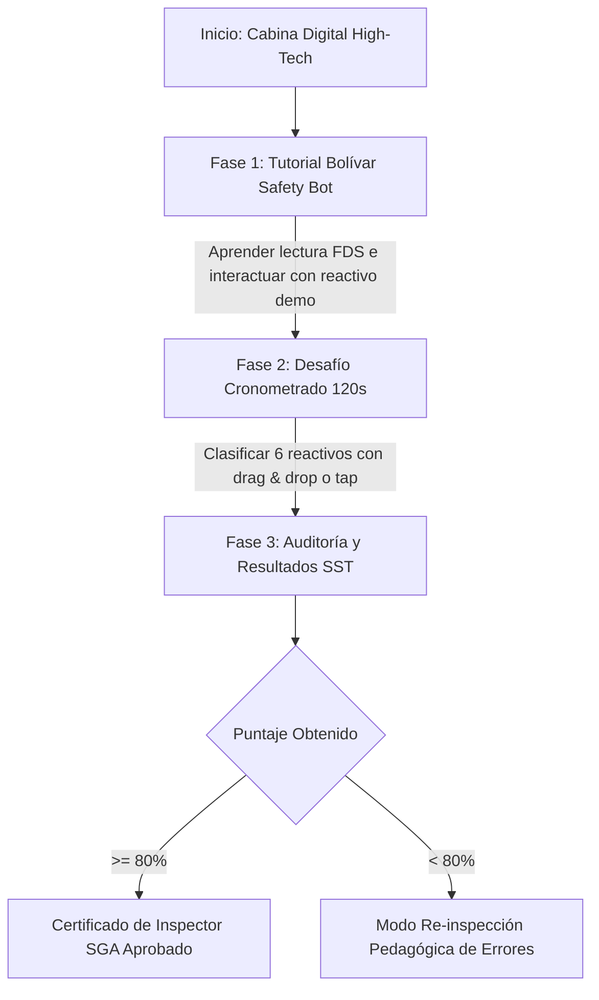

# Documentación Técnica Exclusiva - Juego 1
## Desafío SGA: Clasificación de Peligros y Lectura de FDS

---

## 1. Ficha Técnica y Resumen Ejecutivo

| Parámetro | Especificación Técnica |
| :--- | :--- |
| **Nombre del Módulo** | Desafío SGA: Clasificación de Peligros y Lectura de FDS |
| **Archivo Fuente** | `juego1_sga.html` |
| **Público Objetivo** | Operarios de obra, almacenistas, inspectores SST y supervisores ambientales |
| **Perspectiva / Vista** | UI High-Tech 2D Responsive (Cabina digital con vista vertical tipo tableta industrial) |
| **Viewport Objetivo** | 100vh / Responsive (Enfocado en móviles y tablets, enmarcado ergonómico en PC) |
| **Stack Tecnológico** | HTML5 Semántico, CSS3 Nativo (`:root`), JavaScript ES6 Puro, Web Audio API |
| **Dependencias CDN** | Google Fonts ('Outfit', 'JetBrains Mono'), FontAwesome v6 (`all.min.css`) |
| **Empaquetador / Build** | Cero dependencias / Vanilla JS (Ejecución standalone directa en navegador) |

El **Juego 1** es un simulador interactivo de evaluación y aprendizaje para el Sistema Globalmente Armonizado (SGA). Su objetivo es entrenar la habilidad del personal de construcción e industria para interpretar fichas técnicas FDS (Sección 2: Identificación de Peligros y Sección 8: Controles de Exposición y EPP) y asociar de manera certera el pictograma de peligro oficial correspondiente a sustancias químicas reales utilizadas en frentes de obra.

---

## 2. Marco Normativo y Fundamento Legal

El juego está diseñado en estricto apego al marco regulatorio de seguridad química en Colombia:

1. **Resolución 773 de 2021 (Ministerio del Trabajo y Ministerio de Salud)**:
   - *Artículo 6*: Obligatoriedad de rotulado conforme al Sistema Globalmente Armonizado en los lugares de trabajo.
   - *Artículo 7*: Prohibición tajante de mezclas incompatibles e instrucciones obligatorias de segregación química.
   - *Artículo 12*: Requisitos de etiquetado y comunicación de peligros durante el almacenamiento y trasiego.
   - *Artículo 15*: Disponibilidad y consulta obligatoria de la Ficha de Datos de Seguridad (FDS) de 16 secciones en el puesto de trabajo.
2. **Decreto 1496 de 2018**:
   - Adopción oficial del Sistema Globalmente Armonizado de Clasificación y Etiquetado de Productos Químicos (SGA) en el territorio nacional.
3. **Ley 55 de 1993 (Convenio 170 de la OIT)**:
   - Seguridad en la utilización de los productos químicos en el trabajo y derecho de los trabajadores a conocer los peligros intrínsecos de las sustancias.
4. **Decreto 1072 de 2015 (SG-SST)**:
   - Estándares mínimos para capacitación y prevención del riesgo químico en el Sistema de Gestión de Seguridad y Salud en el Trabajo.

---

## 3. Catálogo de Pictogramas SGA y Reactivos de Obra

### 3.1. Pictogramas Oficiales Modelados (SVG Vectorial Directo)
El simulador incorpora vectores SVG nativos con rombos de borde rojo y fondo blanco para:
- **`inflamable`**: Llama sobre línea horizontal (Líquidos, sólidos o gases inflamables).
- **`corrosivo`**: Tubos de ensayo vertiendo líquido corrosivo sobre barra metálica y mano humana (Corrosión cutánea Cat. 1 y metales Cat. 1).
- **`gas`**: Bombona / cilindro de gas a presión (Gases comprimidos, licuados o disueltos).
- **`salud`**: Silueta humana con estrella de explosión interior en el pecho (Peligro por aspiración, carcinogenicidad, mutagenicidad, toxicidad específica STOT).
- **`toxicidad`**: Calavera y tibias cruzadas (Toxicidad aguda severa oral, dérmica o por inhalación Cat. 1-3).
- **`irritante`**: Signo de exclamación grueso (Irritación cutánea/ocular, sensibilización, narcótico Cat. 2).

### 3.2. Reactivos Químicos Evaluados en Obra

| ID | Nombre Comercial / Químico | Pictograma Correcto | Indicación H / FDS | Base Normativa Aplicada |
| :--- | :--- | :--- | :--- | :--- |
| **`tut_0`** | Desengrasante Industrial Alcalino | **Corrosivo** | H314 (Quemaduras graves) / H290 | Res. 773/2021 Art. 6 (pH > 11.5) |
| **`chem_1`** | Ácido Muriático (HCl 28%) | **Corrosivo** | H314 / H290 (Cat. 1B) / H335 | Dec. 1496/2018 & Res. 773/2021 |
| **`chem_2`** | Thinner / Solvente Corriente | **Peligro Salud** | H304 (Mortal por aspiración) / H373 (STOT RE) | Dec. 1496/2018 (Toxicidad sistémica) |
| **`chem_3`** | ACPM / Combustible Diésel | **Inflamable** | H226 (Líq. inflamable Cat. 3) / H351 | Res. 773/2021 Art. 12 (Trasiego seguro) |
| **`chem_4`** | Cilindro de Acetileno | **Gas Presión** | H280 (Gas comprimido) / H220 | Dec. 1079/2015 & Res. 773/2021 |
| **`chem_5`** | Soda Cáustica en Escamas (98%) | **Corrosivo** | H314 (Cat. 1A) / H318 | Res. 773/2021 Art. 7 (Álcalis puros) |
| **`chem_6`** | Pintura Epóxica Alto Tráfico | **Peligro Salud** | H317 (Sensibilizante) / H341 | Dec. 1496/2018 (Aminas y resinas) |

---

## 4. Experiencia de Usuario y Flujo de 3 Fases

### Fase 1: Inducción Interactiva (Bolívar Safety Bot)
- Diálogo pedagógico asistido por el avatar institucional *Bolívar Safety Bot*.
- Enseña la estructura de la FDS y demuestra cómo una sustancia (Desengrasante alcalino) se clasifica a través de sus frases H y controles de EPP en Sección 8.

### Fase 2: Desafío de Clasificación Rigurosa (75 Segundos)
- Cronómetro regresivo calibrado a **75 segundos** de alta intensidad táctica.
- **Tolerancia Cero e Intento Único Táctico por Reactivo**:
  - *Cero intentos blandos*: Cualquier error en la asignación del pictograma penaliza inmediatamente con **-10 segundos** al cronómetro, rompe la racha técnica a 0, bloquea la tarjeta en rojo y detona sacudida de pantalla con humo y sonido de error.
- **Flujo Reactivo Arcade Puro (Sin Bloqueos de Modales de Preguntas)**:
  - Eliminación total de modales de preguntas y respuestas durante la partida. La interacción es 100% reactiva e instantánea: al emparejar una tarjeta con un pictograma se obtiene retroalimentación inmediata (confeti/ding o sacudida/buzz/-10s) y se avanza de inmediato sin detener al operario.
  - La inspección pedagógica y auditoría detallada de errores (Frases H, normativa y FDS oficial) se consolida en la **Fase 3 (Resultados y Certificación)** mediante el botón interactivo `[Ver FDS]`.
- **Sistema de Racha Arcade (Combo Multiplier)**:
  - Multiplicador visual en tiempo real (`x1`, `x2`, `x3`) en el HUD que premia la consistencia técnica impecable.
- Muestra los 6 reactivos aleatorizados secuencialmente con tarjeta de producto que incluye:
  - Nombre técnico y alias de uso en obra.
  - Botón interactivo `[Inspeccionar FDS]`: Despliega un modal flotante con las 16 secciones oficiales reglamentarias, destacando en dorado las Secciones 2 y 8.
- Soporte dual de control:
  1. **Drag & Drop**: Arrastre físico de la tarjeta hacia el pictograma destino con Pointer Events.
  2. **Tap-to-Select**: Toque en la tarjeta y toque en el pictograma para máxima accesibilidad móvil.

### Fase 3: Auditoría Técnica y Certificación
- Cálculo de calificación porcentual (0% a 100%), racha técnica de aciertos y tiempo restante.
- Desglose analítico de cada reactivo con detalle de intentos empleados (1er intento vs 2do intento).
- Herramienta de **Re-inspección Correctiva**: Permite al operario revisar sus fallos sin reiniciar el juego completo, consolidando la curva de aprendizaje.

---

## 5. Arquitectura de Software y Código

### 5.1. Sistema de Diseño CSS Puro (Sin Tailwind)
- Variables semánticas centralizadas en `:root`:
  - Colores: `--bolivar-green: #006738`, `--bolivar-yellow: #FFC72C`, `--bg-viewport: #0F172A`, `--bg-card: #1E293B`.
  - Escala tipográfica ergonómica: `--font-xs: 0.8125rem` (13px) hasta `--font-2xl: 1.875rem` (30px), garantizando legibilidad en teléfonos bajo luz solar.
- Eliminación total de Tailwind CDN para autonomía de red y velocidad de carga instantánea.
- **Transparencia e Inmunidad de Capas Visuales (`pointer-events: none`)**:
  - Las capas de efectos de partículas (`#fx-canvas`) y globos de cómic (`#comic-reaction-layer`) cuentan con `.pointer-events-none` en el sistema de diseño y `pointer-events: none;` explícito inline, erradicando cualquier bloqueo de eventos de clic, selección o arrastre sobre la interfaz.
- **Controlador Robusto de Arrastre (`setupDragAndDrop`)**:
  - Al iniciar el arrastre sobre una tarjeta química, la escucha de `pointermove` y `pointerup` se delega dinámicamente al objeto global `window`, evitando pérdidas de captura de puntero si el cursor sale de la tarjeta o cuando se aplica la clase `.is-dragging`.
- **Rediseño Integral de Interfaz y Erradicación de Saturación Visual**:
  - **Calibración de Escala Tipográfica**: Estandarización de jerarquía en `:root` (`--font-xs: 12px`, `--font-sm: 14px`, `--font-base: 15px`, `--font-lg: 18px`, `--font-xl: 22px`). Supresión de pesos tipográficos excesivos (`font-weight: 900` generalizado reemplazado por `700` en títulos y `400/500` en cuerpos) para descanso visual.
  - **Desaturación Cromática y Eliminación de Neones**: Supresión de resplandores fluorescentes intensos (`0 0 30px` y `0 0 20px`), gradientes incandescentes y bordes verdes prematuros en tarjetas sin clasificar. Las tarjetas adoptan un fondo oscuro sobrio (`rgba(30, 41, 59, 0.55)`), bordes sutiles en pizarra neutra (`rgba(148, 163, 184, 0.2)`) y estados activos refinados.
  - **Ergonomía Visual en Visor FDS (`#modal-fds`) y Modales Técnicos (`#modal-error-feedback`, `#modal-word-challenge`)**:
    - Visor FDS focalizado exclusivamente en **Sección 2 (Peligros SGA)** y **Sección 8 (EPP y Controles)**, eliminando 3 tarjetas de relleno irrelevante.
    - Modales de error y mini-reto unificados con acentos laterales discretos de 4px (`border-left`), tipografía limpia y botones balanceados.

### 5.2. Motor de Audio Procedimental (`SoundEngine`)
Generación de audio analógico mediante Web Audio API nativa sin archivos `.mp3` ni `.wav`:
- `tap()`: Tono sinusoidal corto en 700 Hz.
- `correct()`: Acorde armónico ascendente C5 (523 Hz) ➔ E5 (659 Hz) ➔ G5 (784 Hz).
- `error()`: Tono en diente de sierra descendente a 150 Hz con vibración.
- `fanfare()`: Fanfarria de victoria tetra-armónica al aprobar el examen.

---

## 6. Pruebas y Casos de Validación

1. **Prueba de Compatibilidad Táctil**:
   - Arrastrar pictogramas en pantallas táctiles iOS / Android: no debe producir scroll involuntario de página (`touch-action: manipulation;`).
2. **Prueba de Modal FDS**:
   - Abrir el visor FDS durante el cronómetro: el modal debe aislar el foco y permitir cerrar con botón `[Cerrar FDS]` o toque fuera del diálogo.
3. **Prueba de Re-inspección**:
   - Al cometer un error intencional, la fase 3 debe marcar la tarjeta con borde rojo, mostrar el pictograma correcto esperado y citar el artículo de la Res. 773/2021.

