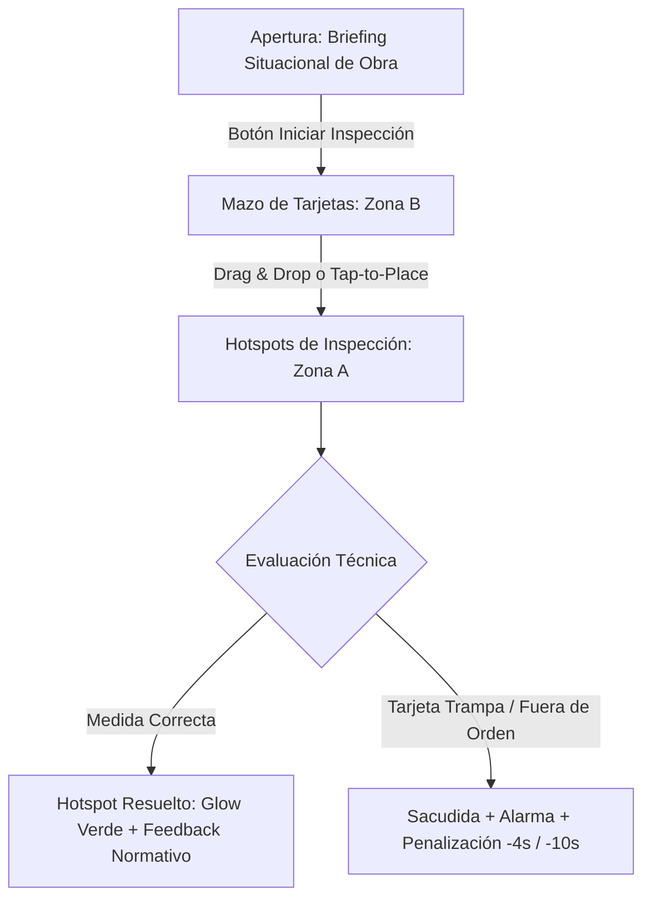

# Documentación Técnica Exclusiva - Juego 3

> **Contrato vigente 2026-10-22:** Trasiego: seis medidas por equipo (cuñas, tierra, motor, bandeja, kit, extintor), cuatro equipos. Presupuesto inicial 70 s, +8 s por equipo hasta 100 s restantes. Nota por equipos completos, independiente de racha. Cierre único y duración real; solo 4/4 aprueba. Aprobación desde 80 % y todos los hitos. [Contrato y validaciones](../CORRECCIONES_2026-10-22.md).
> Las referencias normativas y detalles del diseño original que siguen son contexto histórico, no instrucciones de campo ni acreditación de cumplimiento; prevalece este contrato. Recursos externos incrustados, sin CDN en ejecución. QA visual, lector de pantalla y SST profesional pendientes.
## Inspector de Trasiego: Inspección de Campo y Corrección de Riesgos

---

## 1. Ficha Técnica y Resumen Ejecutivo

| Parámetro | Especificación Técnica |
| :--- | :--- |
| **Nombre del Módulo** | Inspector de Trasiego: Inspección de Campo y Corrección de Riesgos |
| **Archivo Fuente** | `juego3_trasiego.html` |
| **Público Objetivo** | Operadores de carrotanque, maquinistas, inspectores de trasiego y personal SST |
| **Perspectiva / Vista** | Escenario Vectorial SVG 2D de Alta Definición + Mazo de Tarjetas Táctiles |
| **Resolución y Layout** | Diseño responsivo (Zona A: Escena Técnica SVG; Zona B: Mazo de Acción Táctica) |
| **Stack Tecnológico** | HTML5, SVG Nativo, CSS3 Puro (`:root`), JavaScript ES6, GSAP v3, Web Audio API |
| **Efectos Visuales** | GSAP v3 (animación de tarjetas y transiciones) + Canvas 2D Particle Engine |
| **Recursos offline** | Fuentes, Font Awesome 6.4.0 y GSAP 3.12.2 (juegos 3-5) incrustados en HTML |
| **Empaquetador / Build** | Cero dependencias / Vanilla JS (Ejecución standalone directa en navegador) |

El **Juego 3** posiciona al usuario en el rol de un Inspector Técnico de Seguridad durante la operación más crítica de abastecimiento de combustible en obras de infraestructura vial: el **trasiego de hidrocarburos (ACPM UN 1202)** desde el camión cisterna nodriza hacia la maquinaria pesada de movimiento de tierras y generadores eléctricos.

---

## 2. Marco Normativo y Protocolo de Trasiego

El simulador evalúa las medidas obligatorias estipuladas por la legislación colombiana y estándares internacionales:

1. **Decreto 1079 de 2015 (Reglamentario Único del Sector Transporte)**:
   - Sección de Transporte Terrestre Automotor de Mercancías Peligrosas por Carretera (Decreto 1609/2002 compilado).
   - Obligación estricta de conexión equipotencial a tierra antes de conectar mangueras de cargue/descargue para disipar energía estática.
2. **Resolución 773 de 2021**:
   - Identificación y rotulado de combustibles industriales (Líquido Inflamable Categoría 3, UN 1202 ACPM).
   - Controles de ingeniería y prohibición de fuentes de ignición en el radio de operación de vapores.
3. **Decreto 4741 de 2005 y Ley 1333 de 2009 (Régimen Sancionatorio Ambiental)**:
   - Uso obligatorio de bandejas de retención secundaria con capacidad mínima del 110% bajo puntos de acople para impedir contaminación de suelos o fuentes hídricas.
4. **Ley 55 de 1993 y Res. 2400 de 1979**:
   - Supresión de fuentes de ignición térmica (motores encendidos) y eléctricas en atmósferas con presencia de hidrocarburos.
5. **NFPA 10 (Extintores Portátiles) y NFPA 77 (Electricidad Estática)**:
   - Disposición de equipo de extinción Clase B en el perímetro exterior (mínimo extintor satélite rodante a 5 metros).
   - Límites de resistencia de puesta a tierra inferiores a 10 Ohmios.

---

## 3. Escenarios, Hotspots y Catálogo de Medidas Preventivas

El juego presenta 4 frentes de obra secuenciales con retos ambientales y de dificultad creciente:

### 3.1. Maquinaria y Condiciones Ambientales Evaluadas
1. **Excavadora CAT 320D**: Terreno plano, viento moderado. Enfoque en apagado de motor y celular, puesta a tierra y bandeja.
2. **Volqueta Dobletroque Kenworth T800**: Pendiente pronunciada del 12%. Riesgo de rodamiento de tambor y presión hidráulica.
3. **Bulldozer CAT D6T (Oruga)**: Polvareda intensa, temperatura ambiente >35°C. Riesgo de inducción por radiofrecuencia VHF.
4. **Generador Industrial Caterpillar 250kVA**: Área semi-confinada junto a campamentos. Alto riesgo por concentración de vapores y escape caliente a >450°C.

### 3.2. Los 4 Hotspots de Inspección de Campo (Zona A)

| Hotspot | Sector de la Máquina | Medida Preventiva Obligatoria | Fundamento Normativo |
| :--- | :--- | :--- | :--- |
| **`hs_motor`** | Cabina / Motor | **Apagado de motor y aislamiento de celulares** | Turbo a >450°C autoigniciona diésel (210°C). Baterías de litio prohibidas. Ley 55/1993. |
| **`hs_ground`** | Chasis / Masa | **Polo a tierra equipotencial (< 10 $\Omega$)** | Fricción del flujo acumula hasta 15 kV. Se previene chispa en la boquilla. Dec. 1079/2015 / NFPA 77. |
| **`hs_tray`** | Acople / Manguera | **Bandeja antiderrame al 110% de retención** | 1 litro de diésel contamina 1 millón de litros de agua. Retención de fugas. Dec. 4741/2005. |
| **`hs_extinguisher`**| Perímetro (5 metros) | **Extintor satélite ABC 150 lbs en retaguardia** | Autonomía de 45s de sofocación continua ante conatos Clase B. NFPA 10. |

### 3.3. Banco de Distractores Trampa (Por qué son Infracciones Fatales)
El juego incluye tarjetas trampa contextuales por cada vehículo que ponen a prueba el criterio del usuario:
- *Linterna doméstica común*: No tiene certificación intrínseca antiexplosiva (NFPA 70 Clase I Div 1); chispa en interruptor.
- *Extintor de agua a presión*: Error fatal (Boilover). El agua en hidrocarburos Clase B provoca salpicadura violenta de fuego.
- *Arena común de obra*: No es absorbente oleofílico sintético certificado; genera residuo contaminante no confinado (Ley 430/1998).
- *Lavar fuga con manguera*: El ACPM flota sobre el agua, extendiendo el derrame a cunetas y alcantarillas.
- *Mandarria de acero*: Genera chispas mecánicas por fricción. Prohibido acero; solo herramientas de bronce/berilio (OSHA 1910.106).
- *Taponar ducto de venteo*: Genera vacío destructivo en la cisterna durante el bombeo (Dec. 1079/2015).
- *Operar radio VHF a 30cm*: Corrientes parásitas de radiofrecuencia inducen arcos voltaicos en la boquilla.
- *Trapos con solvente sobre turbo*: El múltiple a >450°C causa autoignición espontánea.

---

## 4. Experiencia de Usuario, HUD y Controles

### Pantalla Previa de Contexto Situacional (Briefing Táctico Datapad)
- **Overlay Previo (`#modal-briefing-overlay`)**: Pantalla previa estilo Datapad de Star Wars simplificada y limpia.
- **Situación Operativa**: *"Un camión cisterna está abasteciendo combustible a la maquinaria pesada en frente de obra. Existe alto riesgo de incendio por electricidad estática y derrame de hidrocarburos. Debes ejecutar el procedimiento de trasiego paso a paso conforme a la ley."*
- **Directiva Operativa en 3 Pasos**:
  1. *Inmovilización y Motor*: Bloquea llantas con cuñas y apaga el motor del vehículo.
  2. *Polo a Tierra*: Conecta la pinza antiestática al chasis (<10 Ω).
  3. *Contención y Extintor*: Ubica la bandeja de goteo y el extintor ABC a 5 metros.
- **Instrucciones Directas de Control**: `PC: Arrastrar tarjeta o clic en tarjeta y punto` / `Móvil: Tocar tarjeta y tocar punto`.
- **Botón de Despliegue (`btn-start-briefing`)**: Inicia la inspección y activa la telemetría.

### Controles Ergonómicos y Procedimiento Paso a Paso (SOP / ATS Canónico)
1. **Drag & Drop con Pointer Events**: Arrastre fluido de la tarjeta de seguridad hasta el hotspot visual en la máquina.
2. **Tap-to-Place para Pantallas Táctiles**: Toque en la tarjeta de acción (se eleva con halo dorado) seguido de toque en el hotspot parpadeante en la máquina.
3. **Barra de Guía Secuencial de Ruta (`.trasiego-roadmap-guide`)**:
   - Barra horizontal superior con las 6 etapas del procedimiento oficial de trasiego (Decreto 1079 de 2015, NFPA 77 y Dec. 4741/2005):
     1. **Paso 1: Cuñas en Llantas** (Inmovilización mecánica obligatoria).
     2. **Paso 2: Motor / Cabina** (Apagado de motor y bloqueo de celulares).
     3. **Paso 3: Polo a Tierra** (Conexión equipotencial < 10 $\Omega$ al chasis).
     4. **Paso 4: Bandeja de Goteo** (Contención secundaria al 110% bajo el acople).
     5. **Paso 5: Kit de Derrames** (Alistamiento de material absorbente in situ).
     6. **Paso 6: Extintor ABC 150 lbs** (Protección perimetral a 5 metros contra el viento).
   - El paso activo parpadea en halo dorado (`.step-active`), los pasos superados se marcan en verde con checkmark (`✓ Hecho`), y los pasos futuros permanecen bloqueados (`🔒 Paso X`).
   - El hotspot en el SVG correspondiente al paso activo pulsa intensamente con su número y etiqueta (`PASO X: [NOMBRE]`), mientras los demás muestran advertencia de espera (`🔒 ESPERA PASO X`).
4. **Penalización Directa y Cero Pistas Gratuitas**:
   - Cada intento fuera de orden penaliza inmediatamente **-4 segundos y -25 puntos**, sacudiendo la pantalla y señalando con animación el punto activo requerido.
   - El uso de tarjetas trampa descuenta **-10 segundos y -100 puntos**.
5. **Telemetría en Vivo y Dinamismo (HUD)**:
   - Medidor de racha técnica con multiplicador de puntaje (`x1`, `x2`, `x3`).
   - Cronómetro arcade calibrado a **70 segundos base** con **bonificación de +8 segundos de tiempo extra** por cada frente de obra completado.
   - Píldora de estado del vehículo en curso (`1/4`, `2/4`, `3/4`, `4/4`).

---

## 5. Arquitectura de Software

- **`FieldInspectorGame`**: Controlador central que gestiona el estado de los vehículos, la validación de hotspots, el cálculo de puntaje y el cambio de escena SVG.
- **`ProceduralAudioEngine`**: Síntesis en tiempo real de tonos de éxito armónico, clank metálico de acoples, alarmas estroboscópicas de error y fanfarria de certificación.
- **`CanvasParticleEngine`**: Sistema de partículas en canvas para chispas en errores de ignición y confeti en la aprobación de la auditoría.
- **Feedback Normativo en Tiempo Real (`normativeFeedback`)**: Renderizado dinámico de tarjetas explicativas con viñetas de cómic técnico.

---

## 6. Pruebas y Validación Funcional

1. **Prueba de Infracción Crítica**:
   - Arrastrar un distractor (ej. "Extintor de Agua") sobre el hotspot del motor: el sistema debe descontar racha, vibrar en rojo y desplegar el toast de error pedagógico ("Boilover fatal").
2. **Prueba de Transición de Escena**:
   - Al completar los 4 hotspots del vehículo 1, la escena SVG debe ejecutar una transición suave mediante GSAP hacia el vehículo 2, actualizando condiciones ambientales y barajando el mazo de tarjetas.
3. **Prueba de Certificación Final**:
   - Al superar los 4 frentes de obra, se emite el certificado oficial de "Inspector Técnico de Trasiego Seguro" conforme al Dec. 1079/2015.

---

## 7. Control de Inicialización y Modal de Briefing Situacional

- **Flujo de Inicio Controlado**: Al cargar la página, se despliega el modal de contexto en obra (`#modal-briefing-overlay`). El temporizador permanece en espera (`01:10`) y el juego inactivo (`isGameActive = false`) para evitar consumir tiempo mientras el operador asimila la misión.
- **Transición y Audio Seguro**: Al pulsar `#btn-start-briefing`, se ejecuta `ProceduralAudioEngine.playTap()`, se oculta el modal (`.hidden`), se activa la partida y se dispara el cronómetro (`this.startTimer()`), sincronizando la ruta de pasos y controles.

- **Estabilización y Centrado Universal de Notificaciones**: El panel `#tech-feedback-toast` se rediseñó con anclaje superior universal (`top: 56px; left: 12px; right: 12px; max-width: 580px; margin: 0 auto; transform: translateY(-20px);`), eliminando el bug de desplazamiento horizontal por `translateX(-50%)` en móvil que cortaba el 50 % del mensaje a la izquierda. Incorpora botón de cierre rápido `[×]`, descarte por toque en pantalla y tipografía adaptativa para advertencias de error y aciertos técnicos.

---

## 8. Ilustración SVG Dinámica y Coordenadas Adaptativas por Vehículo

El escenario de trasiego cuenta con renderizado vectorial dinámico para cada uno de los 4 frentes de obra:

1. **Catálogo de Gráficos SVG Anatómicos (`#machinery-truck`)**:
   - **Excavadora CAT 320D (`getExcavatorSvg()`)**: Tren de orugas de acero con 5 rodillos, pluma hidráulica segmentada, cuerpo y contrapeso amarillo CAT, cabina con operador Lucho y boquilla de diésel izquierda.
   - **Volqueta Kenworth T800 (`getDumpTruckSvg()`)**: Cabina trompuda americana Kenworth con visera, escape vertical cromado alto con silenciador, tolva de volteo inclinada reforzada, doble troque trasero y tanque de diésel lateral de aluminio con boca de llenado.
   - **Bulldozer CAT D6T (`getBulldozerSvg()`)**: Tren de rodaje triangular distintivo *High-Drive* Caterpillar con rueda motriz elevada, pala topadora delantera (*blade* pesado) con pistones hidráulicos, cabina ROPS blindada con jaula estructural y boca de combustible trasera.
   - **Generador Industrial 250kVA (`getGeneratorSvg()`)**: Skid de acero estructural con cáncamos de izaje, cabina acústica insonorizada modular con lamas de ventilación, panel de control digital PowerWizard con tacómetros y botón de parada de emergencia (*STOP* tipo hongo), silenciador en techo y boca lateral.

2. **Matriz de Coordenadas Adaptativas (`VEHICLE_CONFIGS`)**:
   - Cada vehículo define de forma paramétrica sus puntos clave en **Desktop** y **Móvil**:
     - Posición del grupo receptor (`machineTransform`).
     - Trayectoria Bézier de la manguera de trasiego (`hose`) desde la cisterna nodriza hasta el tanque receptor.
     - Trayectoria y pinza de masa del cable equipotencial de polo a tierra (`groundCable` y `clamp`) hacia el chasis metálico.
     - Ubicación de la bandeja colectora antiderrame (`dripTray`), extintor satélite (`extinguisher`), cuñas de inmovilización (`wheelChocks`) y kit de derrames (`spillKit`).
     - Posición adaptativa exacta de los 6 hotspots de inspección (`hotspots[1..6]`).
   - Al avanzar de vehículo o redimensionar la pantalla, `applySvgResponsiveLayout()` sincroniza la geometría en tiempo real garantizando cero colisiones y ergonomía táctil en cualquier resolución.

