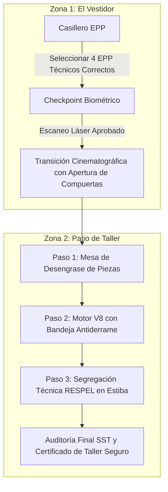

# Documentación Técnica Exclusiva - Juego 4
## Taller Seguro: Desafío Isométrico de Equipamiento y Mantenimiento

---

## 1. Ficha Técnica y Resumen Ejecutivo

| Parámetro | Especificación Técnica |
| :--- | :--- |
| **Nombre del Módulo** | Taller Seguro: Desafío Isométrico de Equipamiento y Mantenimiento |
| **Archivo Fuente** | `juego4_taller.html` |
| **Público Objetivo** | Mecánicos de taller, cuadrillas de mantenimiento, supervisores SST y jefes de patio |
| **Perspectiva / Vista** | 2.5D Isométrica pura con 2 Escenarios Autónomos (`#stage-vestidor` y `#stage-workshop`) |
| **Espacio de Escenario** | Mundo 500x500px, Viewport de 640px de altura, cuadrícula 5x5 (baldosas de 100x100px) |
| **Stack Tecnológico** | HTML5, CSS3 Nativo (`:root`), JavaScript ES6, GSAP v3, Web Audio API |
| **Sistema de Cámara** | Rotación 3D en 90° con Billboarding dinámico y Paneo/Zoom con 2 dedos en móviles |
| **Dependencias CDN** | GSAP 3.12.2, Google Fonts ('Outfit'), FontAwesome v6 |
| **Empaquetador / Build** | Cero dependencias / Vanilla JS (Ejecución standalone directa en navegador) |

El **Juego 4** es un simulador isométrico 2.5D de alta fidelidad que entrena al personal en dos etapas obligatorias del trabajo en talleres industriales: primero, el correcto **equipamiento y dotación de EPP químico en el vestidor** con validación biométrica de acceso; segundo, la **ejecución segura de mantenimientos mecánicos y segregación integral de residuos peligrosos (RESPEL)** en el patio exterior.

---

## 2. Marco Normativo y Exigencias Técnicas

1. **Resolución 773 de 2021 (Artículos 6, 7 y 8)**:
   - Selección obligatoria de Elementos de Protección Personal (EPP) con base en la Sección 8 de la FDS para solventes, hidrocarburos y desengrasantes.
2. **Decreto 4741 de 2005 (Gestión Integral de Residuos Peligrosos - RESPEL)**:
   - Segregación en origen de residuos impregnados de hidrocarburos (filtros, trapos de taller y aceite lubricante usado).
   - Obligación de estibado sobre plataformas con contención secundaria para evitar la filtración de aceites hacia el suelo natural.
3. **Resolución 2400 de 1979 (Estatuto de Seguridad Industrial)**:
   - Demarcación de zonas de trabajo en talleres mecánicos, pasillos de circulación y orden y aseo en bancos de desengrase.
4. **Normas Técnicas ANSI Z358.1 (Equipos de Lavado de Emergencia) y NFPA 10 (Extintores)**:
   - Disponibilidad y operatividad de extintores de 20 lbs y estaciones de lavaojos en el perímetro de mantenimiento.

---

## 3. Escenarios, Dinámicas y Tareas Operativas



### 3.1. Zona 1: El Vestidor de Bioseguridad
- **Casillero de Dotación EPP (Margen de Error Pedagógico)**:
  - El operario debe seleccionar los **4 EPP requeridos** para solventes orgánicos y aceites pesados:
    1. *Respirador con cartuchos para vapores orgánicos y prefiltro P100*.
    2. *Guantes de nitrilo o neopreno de caña alta* (alta resistencia química a hidrocarburos).
    3. *Monogafas químicas herméticas* con ventilación indirecta contra salpicaduras.
    4. *Botas de seguridad con puntera de acero y suela dieléctrica resistente a aceites*.
  - El casillero cuenta con **4 distractores trampa** (tapabocas quirúrgico, guantes de algodón porosos, gafas oscuras de sol y calzado deportivo de lona).
  - **Barajado Aleatorio e Intercalado Dinámico (Fisher-Yates) y Neutralidad Cromática**: Las 8 tarjetas se mezclan e intercalan dinámicamente en el grid cada vez que se accede al casillero, impidiendo la memorización de cuadrante o patrones espaciales fijos. Todas las tarjetas (correctas y trampas) poseen el mismo diseño visual sobrio y neutro, con iconos técnicos homologados y descripciones realistas, eliminando alertas rojas o textos delatores ("¡Peligro!") para obligar al operario a leer con atención crítica.
  - **Penalización Rigurosa en Casillero**: Equipar una prenda no homologada penaliza inmediatamente con **-15 segundos** al cronómetro, descuenta **-100 puntos**, rompe la racha a 0 y activa alerta roja de bioseguridad.
- **Checkpoint Biométrico y Puerta Blindada (Tolerancia Cero)**:
  - Escáner láser interactivo de inspección corporal.
  - **Rechazo Punitivo Inmediato**: Cero intentos gratuitos. Si el operario se presenta con EPP incompleto o prendas no homologadas, el escáner se ilumina en rojo (#EF4444), descuenta **-15 segundos**, resta **-100 puntos**, rompe racha y expulsa físicamente al avatar hacia atrás, obligándolo a reconfigurar su dotación bajo presión de tiempo.
  - Al completar el 100% del equipo reglamentario (4/4 EPP sin trampas), se desbloquea la compuerta con sonido hidráulico y transición cinematográfica hacia el patio de mantenimiento.

### 3.2. Zona 2: Patio de Taller de Mantenimiento (Mini-Retos Interactivos y Riesgo Ambiental)
Guiado por una barra superior de ruta (`workshop-roadmap-guide`) y balizas 3D flotantes con pulso dorado:
1. **Paso 1: Mesa de Desengrase (Mini-Reto Operacional FDS Sec. 8)**:
   - Al tocar la mesa, se despliega un mini-reto de control operacional: elegir entre la técnica reglamentaria (frotado manual con paño técnico en área ventilada) y una práctica insegura (sopletear con aire a alta presión sobre balde abierto).
   - **Neutralidad de Opciones**: Las alternativas se presentan en orden aleatorio con fondos neutros uniformes (`rgba(30, 41, 59, 0.85)`) y bordes estándar, sin ningún sombreado o delación en verde antes de que el jugador tome su decisión.
   - Error penaliza con **-10 segundos** y **-50 puntos**. Acierto desencadena spray, animación de pulido y +85 pts con racha.
2. **Paso 2: Soporte con Motor V8 (Riesgo Ambiental Crítico - Dec. 4741/2005 & Ley 1333/2009)**:
   - Mini-reto de contingencia ambiental: seleccionar la instalación obligatoria de bandeja recolectora y paño oleofílico antes de desenroscar el filtro.
   - Opciones barajadas con idéntico tratamiento cromático neutro previo a la elección.
   - **Infracción Ambiental Severa**: Intentar drenar o cambiar filtro sin bandeja dispara *¡DELITO AMBIENTAL!*, penaliza con **-20 segundos** al cronómetro, descuenta **-150 puntos**, rompe racha y activa la animación de derrame de hidrocarburos en la base colectora (`.engine-spill-active`).
   - Acierto posiciona la bandeja, extrae el filtro, drena el fluido en contención y suma +85 pts con racha.
3. **Paso 3: Estación de Segregación RESPEL en Estiba Continua**:
   - Modal interactivo con **CSS Grid 3x1** para clasificar 3 residuos contaminados en sus recipientes normativos:
     - *Caneca 1 (Filtros)*: Filtros metálicos de aceite usados.
     - *Caneca 2 (Trapos)*: Trapos y waypes impregnados con solvente/grasa (residuo inflamable).
     - *Tambor Colector (Aceite sobre Estiba)*: Aceite lubricante usado (Dec. 4741/2005).
   - **Neutralidad Cromática en Iconografía**: Los iconos de los residuos en bandeja utilizan un tono neutro uniforme (`#94a3b8`) sin tintes amarillos ni rojos previos, impidiendo que el jugador empareje residuos por colorimetría obvia con las canecas roja y amarilla.
   - Error en segregación penaliza con **-4s** y **-40 pts**. Acierto suma +50 pts.

---

## 4. Innovaciones de Arquitectura y Algoritmos Isométricos

### 4.1. Sistema de Rotación 3D en 90° con Billboarding Dinámico
El motor permite rotar el escenario en los 4 rumbos cardinales (`0°`, `90°`, `180°`, `270°`) mediante un único botón limpio en el HUD (`[ 🔄 Girar 90° ]`):
- Los sprites del avatar y de los props utilizan variables CSS dinámicas:
  ```css
  --counter-rot-z: calc(-1 * var(--current-rot-z));
  --counter-rot-x: -60deg;
  ```
- Al rotar la escena, cada objeto y el operador giran en contrasentido sobre su eje base (`transform-origin: 50% 100%`), garantizando que siempre miren de frente a la cámara sin sufrir deformaciones trapezoidales ni aplastamiento visual.

### 4.2. Algoritmo Tap-to-Move sin Puntos Muertos
1. **Anclaje Z=0 del Avatar**:
   - Se configuró `margin-left: -28px; margin-top: -96px;` en el sprite de 56x96px. La posición GSAP de los pies coincide con precisión milimétrica ($\Delta = 0$) con el centro exacto de la baldosa pulsada en cualquier ángulo de rotación.
2. **Erradicación de Puntos Muertos entre Baldosas**:
   - Cada baldosa `.iso-tile` posee `margin: -2px; padding: 2px; box-sizing: content-box;`, creando un solapamiento geométrico de 4px en todas las aristas y esquinas. Se eliminan rendijas subpixel de clic.
   - El contenedor general `.iso-room-zone` cuenta con respaldo matemático de clic que calcula la celda `(col, row) = (Math.floor(x / 100), Math.floor(y / 100))` ante impactos en las costuras perimetrales.

### 4.3. Navegación Táctil Móvil con Dos Dedos (Two-Finger Pan & Pinch Zoom)
Para evitar que el usuario desplace la cámara por error cuando intenta caminar:
- **1 Dedo**: Dedicado al 100% al movimiento del avatar (Tap-to-Move), interacción con casilleros y selección de estaciones.
- **2 Dedos**: Escucha de eventos multitáctiles (`e.touches.length === 2`) que calculan el punto medio para traslación libre del escenario (`panX`, `panY`) y la distancia euclidiana para zoom por pellizco (`pinch-to-zoom`).
- **Protección contra Toques Fantasma**: Bandera de supresión de 120ms al levantar los dedos para evitar clics accidentales al terminar el paneo.

---

## 5. Control de Calidad Visual y Accesibilidad (Anti-Clutter & Anti-Blur)

1. **Eliminación de preserve-3d en Sprites 2D**:
   - Los carteles y props se renderizan planos sin `preserve-3d`, activando DirectWrite y ClearType para tipografías 100% nítidas y cristalinas sobre fondos oscuros.
2. **Estabilidad Geométrica en Tarjetas RESPEL**:
   - Reemplazo de Flexbox dinámico por CSS Grid 3x1 rígido con badges de visibilidad fija, impidiendo que la tarjeta de aceite se desborde o altere su tamaño al ser depositada.
3. **Cronómetro Táctico de Alta Exigencia**:
   - Temporizador de desafío calibrado en **90 segundos (01:30 minutos)** para simular presión operacional real en planta sin tolerancias blandas.

---

## 6. Pruebas y Validación Funcional

1. **Prueba de Rotación 360° en Marcha**:
   - Hacer caminar al avatar hacia el motor y presionar `[Girar 90°]`: el avatar y los props deben mantenerse en pie encarando la cámara, y el destino de caminata debe conservarse en el centro de la baldosa.
2. **Prueba de Checkpoint Faltante**:
   - Intentar cruzar la puerta del vestidor con solo 3 EPP seleccionados: el escáner debe sonar en tono de error y el Bolívar Safety Bot debe listar el EPP faltante.
3. **Prueba de Multitáctil en Teléfono**:
   - Tocar con 1 dedo una baldosa (el personaje camina); deslizar con 2 dedos (la cámara se traslada sin hacer caminar al personaje).

